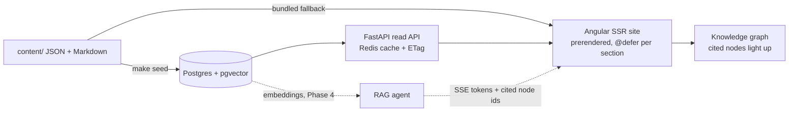

# Chandrashekhar: AI-native portfolio

**Live: [chandrashekhar.pages.dev](https://chandrashekhar.pages.dev)**

Angular 22 · FastAPI · PostgreSQL + pgvector · Redis · RAG agent · Knowledge graph · MCP

> Frontend engineer who builds complex UIs (CAD/DXF viewers, PDF engines, data-extraction tools), now building
> the AI systems behind them.

Not a template. My skills, projects and jobs live in one knowledge graph; an agent answers questions
about me from it, and the nodes each answer cites light up.

## Things to try on the site

- **Ask the agent** (`Ctrl/⌘ K` → "Ask my agent"), then watch the graph glow on the nodes it cited.
- **Explore the graph**: hover a few nodes and the side panel sums up your trail ("6 nodes, mostly CAD")
  with a follow-up question.
- **Blueprint mode** (footer button): the page redrawn as a CAD drawing, with dimension lines showing
  real section sizes, a crosshair with page coordinates, and labels showing which section loaded when (`@defer #2 · +1.4 s`).
- **Open DevTools** and type `chandrashekhar.help()`.
- **Any case study** → "Ask my agent about this project".

## How it works



The graph is derived from the content (skills, projects, roles, education), by the same rules in
TypeScript and Python, checked against one shared fixture. The chat speaks one event contract
(`meta → token… → citations → done`): today a scripted source answers from the content, and in Phase 4 the real
SSE agent replaces it without touching the UI.

## Status

| Phase                                                              |                                        |
| ------------------------------------------------------------------ | -------------------------------------- |
| 0 · Foundation (monorepo, CI, schemas, confidentiality check)      | ✅                                     |
| 1 · Frontend (every section, graph, ⌘K, SEO, a11y, Lighthouse 100) | ✅ live                                |
| 2 · Backend core (Postgres, seed, cached read API, contact API)    | ✅ built, API not hosted yet           |
| 3–4 · Admin panel, RAG agent with citations                        | next                                   |
| 5–9 · Recruiter JD match, voice lab, MCP server, demos, hardening  | planned ([docs/plan.md](docs/plan.md)) |

Quality gates on every PR: ESLint + Prettier, ruff + mypy strict, ~160 unit tests (web) + Python tests on
real Postgres/Redis, ~165 Playwright e2e on desktop and mobile, 48 screenshot baselines, axe (0 serious),
Lighthouse ≥ 95, gitleaks.

## Repository layout

| Path          | What                                                                  |
| ------------- | --------------------------------------------------------------------- |
| `apps/web`    | Angular SSR site (standalone, signals, zoneless)                      |
| `apps/api`    | FastAPI backend (`portfolio_api`): REST + SSE chat                    |
| `apps/worker` | Ingestion worker (`portfolio_worker`): parse → chunk → embed → upsert |
| `apps/mcp`    | MCP server (`portfolio_mcp`) for AI agents                            |
| `content/`    | Seed content (JSON + Markdown) and its JSON Schemas                   |
| `infra/`      | Docker Compose for Postgres/pgvector, Redis, Ollama                   |
| `scripts/`    | Repo tooling (content validator)                                      |
| `docs/`       | PRD, design, architecture, API, plan, backlog …                       |
| `prototype/`  | Single-file HTML prototype: visual reference only                     |

## Quick start

Requirements: Node ≥ 22.22.3 + pnpm 10, [uv](https://docs.astral.sh/uv/) (installs Python 3.13), Docker.

```bash
make setup      # pnpm + uv installs, git hooks, creates .env from .env.example
make up         # Postgres (localhost:5433) + Redis (localhost:6380)
make dev-api    # http://localhost:8000/docs
make dev-web    # http://localhost:4200
make check      # lint, types, content, tests, build, SSR and e2e
```

Run `make visual` and `make lighthouse` for the separate screenshot and performance gates.
Run `make` to list every task. Contribution rules and branch protection: [docs/CONTRIBUTING.md](docs/CONTRIBUTING.md).

## License

Code: [MIT](LICENSE). Content in `content/` (text, photos, resume): © Chandrashekhar, all rights reserved.
