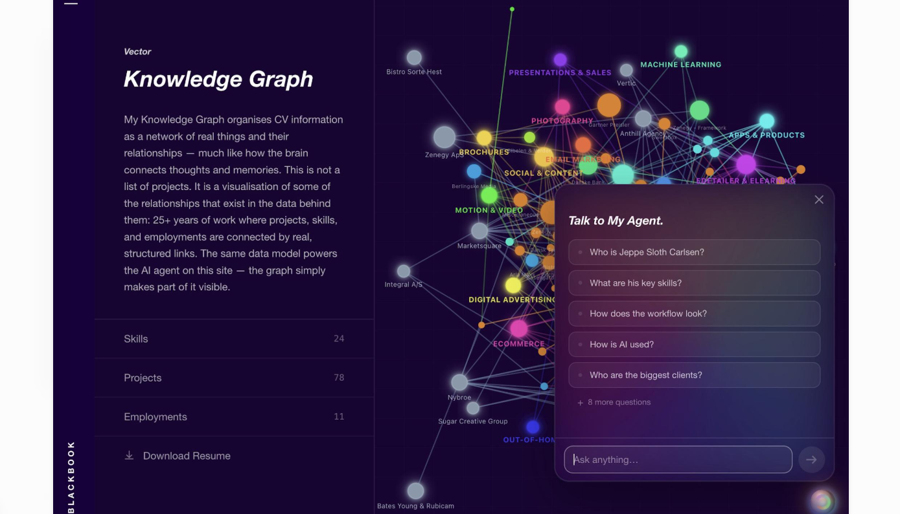
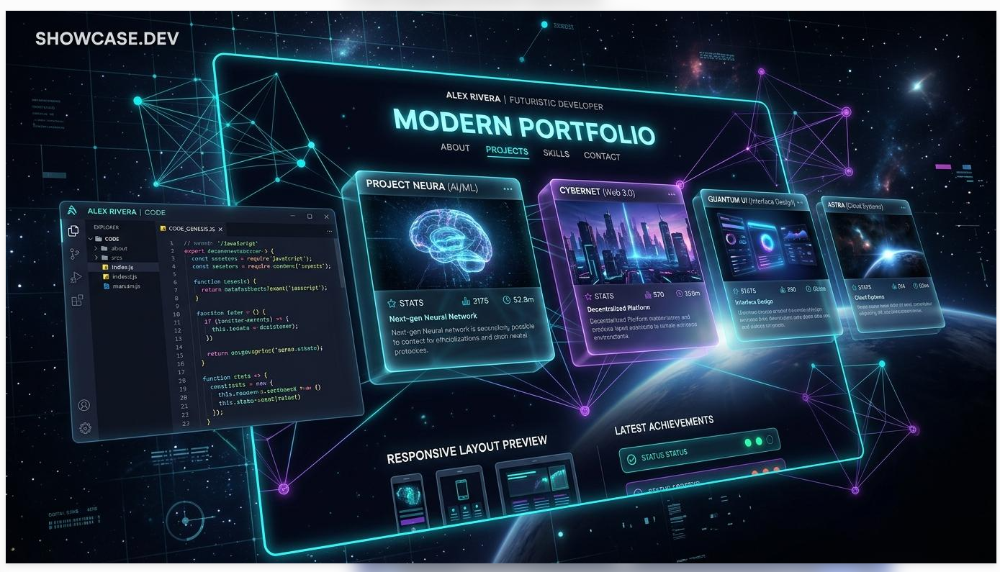
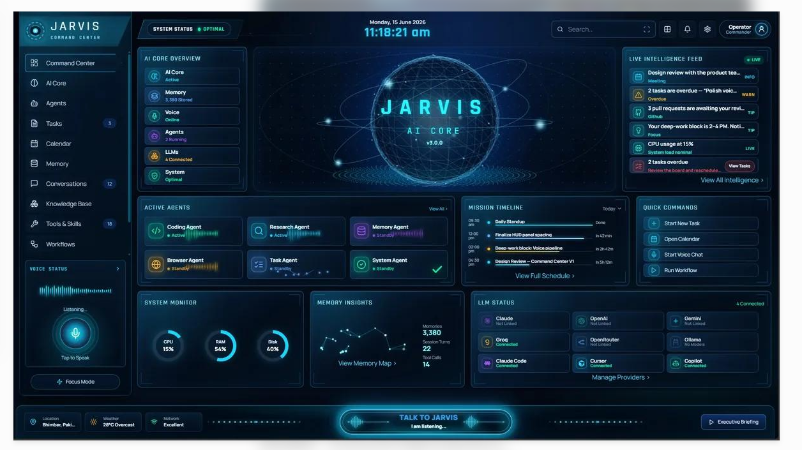

# Your idea is strong. Here's how to make it unforgettable — and shippable.

Most developer portfolios are either a beautiful static page or a 3D toy. Yours can be something rarer: **a portfolio that is itself a working AI system**, built by a frontend engineer who visibly levels up into AI engineering. The signature idea: **a knowledge graph of your career that the AI agent cites** — ask a question, the answer streams in, and the nodes it used light up.

### Positioning line (use on the hero)

“Frontend engineer who builds complex UIs — CAD editors, PDF engines, data grids — now building the AI systems behind them.” This turns your Angular depth into an asset for AI-engineering roles instead of something you're leaving behind.

## A Scorecard — every idea you listed

| Idea | Value | Relevance | Feasibility now | Verdict | Note |
|---|---|---|---|---|---|
| Responsive, dynamic, lazy-loaded, secured, optimised | 5/5 | 5/5 | 5/5 | **Build (MVP)** | Non-negotiable baseline. Angular SSR + @defer covers lazy loading natively. |
| Frontend + backend + REST + FastAPI | 5/5 | 5/5 | 4/5 | **Build (MVP)** | Great learning arc. Start with 4–5 read endpoints; add writes later. |
| AI agent that answers questions about you | 5/5 | 5/5 | 4/5 | **Build (MVP)** | The headline feature. Must be RAG-grounded with citations, rate-limited, budget-capped. |
| Knowledge-graph node animation (ref #3) | 5/5 | 5/5 | 4/5 | **Build (MVP)** | Signature visual — make it the agent’s citation map. |
| 3D / 2D, cursor, text, card animations | 4/5 | 4/5 | 4/5 | **Build, scoped** | One hero moment + micro-interactions; lazy-load Three.js. |
| Dark / light, premium feel | 4/5 | 5/5 | 5/5 | **Build (MVP)** | Token-based theming from day one. |
| Voice agent like Jarvis | 4/5 | 4/5 | 3/5 | **Build, scoped** | A mode in /lab. Web Speech API first, realtime voice later. |
| Full Jarvis command-center dashboard (ref #5) | 3/5 | 2/5 | 3/5 | **Backlog** | Too dense for a landing page; borrow HUD style for /lab only. |
| Showcase CAD editor, PDF rendering, PrimeNG tables | 5/5 | 5/5 | 4/5 | **Build (MVP)** | Real differentiator — make small live demos. |
| LLM / model on the site | 4/5 | 4/5 | 4/5 | **Build, scoped** | Hosted APIs via backend; self-hosting adds cost with no visitor benefit. |
| MCP, agents, skills docs | 4/5 | 5/5 | 5/5 | **Build (MVP)** | Docs also feed the RAG index. |
| Learning LangChain + other AI tools | 5/5 | 5/5 | 4/5 | **Build (MVP)** | Raw SDK + RAG first, then LangChain/LangGraph. |

## B Your 5 reference images — analysis

### \#1 · Holographic AI workstation

Mood board, not a layout: blue holograms, “Code intelligence · Test automation · MCP tool integration”, a pipeline of steps feeding a cloud.

Steal the **pipeline strip** idea (document → code → test → deploy icons with animated arrows) for an “How I work with AI” section. Don’t use the image itself — it’s generic AI-stock art and heavy.

*Idea value: 5 · concept/5 · Use as-is: 2 · as asset*

### \#2 · Starfield + wave grid

Deep navy sky, twinkling stars, a violet surface curving over a perspective grid. Calm, premium, cheap to render.

**Used as the hero background** in the prototype (canvas, ~2 KB of code). Perfect: atmospheric yet readable, and it parallaxes with the mouse.

*Idea value: 5/5 · Use as-is: 5*

### \#3 · Knowledge graph + “Talk to my agent”

Jeppe Sloth Carlsen’s Blackbook: CV as a node graph with category labels, side panel with counts, and an agent with suggested questions.

The **strongest reference**. Adopted: left panel + counts, coloured category clusters, suggested-question chat. Your twist: chat answers **light up the cited nodes**.

*Idea value: 5/5 · Use as-is: 4*

### \#4 · “Modern portfolio” glass mockup

AI-generated mockup: glass cards, code editor panel, neon frame, responsive preview. Text is garbled (generated).

Borrow the **glass card + neon edge** look for project cards and a code-panel motif. Avoid the overloaded composition — too many competing panels.

*Idea value: 3/5 · Use as-is: 3*

### \#5 · JARVIS command center

Dense HUD dashboard: AI core sphere, agents, timeline, LLM status, voice bar.

Great for an **/lab page** showing your agents honestly (status, models, latency). As a homepage it overwhelms; used as one section in the prototype.

*Idea value: 4/5 · Use as-is: 3 · as homepage*

## C High-profile public portfolios — what to borrow

Bruno Simon

bruno-simon.com

A Three.js game: drive a little car through a 3D world to discover projects. Full source is public on GitHub.

Borrow: one bold, playful signature idea. Avoid: making visitors work to find basic info.

Brittany Chiang

brittanychiang.com

Minimal dark layout, sticky left column, crisp typography — the most-cited developer portfolio.

Borrow: content clarity, scannable experience list, restraint.

Jeppe Sloth Carlsen (Blackbook)

your reference \#3

CV as a knowledge graph + an AI agent with suggested questions.

Borrow: graph + agent pairing. Beat it: graph-cited answers, JD match, MCP.

Josh W. Comeau

joshwcomeau.com

Playful micro-interactions, sound, whimsical but performant details.

Borrow: delight in small moments (buttons, hovers), not big effects.

Rauno Freiberg

rauno.me

Interaction-design craft: tiny, precise, polished experiments.

Borrow: a “craft” page of small UI experiments — fits your animation skills.

Lynn Fisher

lynnandtonic.com

Re-designs her site every year; responsive behaviour itself is the art.

Borrow: show responsiveness as a feature; keep a changelog of redesigns.

## D What you didn't list — but should add

### Proof, not just polish

- Case studies with problem → approach → result → what you'd do differently
- Live mini-demos of your niche: a tiny CAD canvas, a PDF viewer, a 100k-row virtual table
- “Learning in public” log: Python → FastAPI → RAG, with dated entries
- GitHub activity + pinned repos pulled from the API

### AI features that stand out

- Graph-grounded answers with clickable citations
- Recruiter mode: paste a JD → honest fit report
- Portfolio as an **MCP server** + `/llms.txt` so other AI agents can query you
- A public “agent eval” page: accuracy, refusal, latency — shows engineering maturity

### Engineering hygiene recruiters notice

- Lighthouse ≥ 95, CWV green, budget enforced in CI
- WCAG 2.2 AA, keyboard nav, `prefers-reduced-motion`
- OG images per page, sitemap, JSON-LD Person schema
- Privacy-friendly analytics (Umami / Plausible)

### Security & cost (the AI part bites here)

- No API keys in the browser — all LLM calls via FastAPI
- Rate limit per IP + Turnstile + daily token budget kill-switch
- Prompt-injection guardrails; answer only from your data
- Cache frequent questions; cheap model for routing

## E Honest risks

### Scope explosion

You listed ~15 big features. Ship the MVP (static Angular site + graph + scripted chat) in 3 weeks; add the real backend after. A live small site beats a perfect unfinished one.

### Effects vs. content

Recruiters scan for ~30–60 s. Heavy 3D on load hurts LCP and mobile. Rule: content first-paint, effects lazy, every effect skippable.

### AI hallucination about you

An agent that invents a skill is worse than no agent. Strict RAG, citations, “I don't know — ask him” fallback, and an eval set of 50 Q&A pairs.
